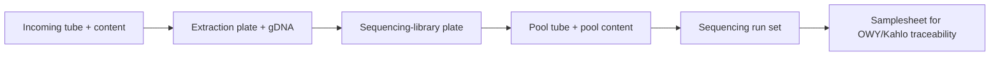

<div align="center">
<pre>
██████╗ ██╗      ██████╗  ██████╗ ███╗   ███╗
██╔══██╗██║     ██╔═══██╗██╔═══██╗████╗ ████║
██████╔╝██║     ██║   ██║██║   ██║██╔████╔██║
██╔══██╗██║     ██║   ██║██║   ██║██║╚██╔╝██║
██████╔╝███████╗╚██████╔╝╚██████╔╝██║ ╚═╝ ██║
╚═════╝ ╚══════╝ ╚═════╝  ╚═════╝ ╚═╝     ╚═╝
</pre>
<p><strong>Internal material, container, lineage, and lab-action graph service.</strong></p>
<p>
  <a href="#quickstart">Quickstart</a> ·
  <a href="#api">API</a> ·
  <a href="#gui">GUI</a> ·
  <a href="docs/lab_actions.md">Lab actions</a> ·
  <a href="#release-and-validation-policy">Releases</a>
</p>
</div>

## Overview

Bloom is the LSMC internal material and container graph service. It owns laboratory containers, materials/content, equipment, lineage, recursive template creation, search, and graph views. Atlas owns orders and customer-facing accession context; Bloom owns the physical/material execution graph.

Source release: `10.0.4`. Exact TapDB dependency: `daylily-tapdb[aurora,gui]==10.1.3` (see `pyproject.toml`). Python 3.12 or newer is required; the Bloom version is derived from Git by setuptools-scm.

The accepted deployment recorded on 2026-09-12 is Bloom `10.0.3` at `https://bloom.day.lsmc.bio`, with Kahlo `8.0.1` consuming its native DAG v2. The later phase-2 patch and deployment are tracked in the [phase-2 execution ledger](docs/plans/20260912T053000Z_bloom_phase_2_execution_ledger.md). See the [completed migration ledger](docs/plans/20260911T150553Z_bloom_tapdb_10_1_migration_ledger.md) and [phase-2 backlog](docs/plans/20260912T045329Z_bloom_phase_2_backlog.md).

Bloom is internal-only in Dayhoff exposure policy. It must be reachable only through approved LSMC networks and Dayhoff-generated service credentials.

TapDB template identity is semantic. Categories are names like `container`, `material`, `data`, `equipment`, `set`, and `workflow`; prefixes such as `BC*`, `BN*`, `BD*`, `BR*`, and `BG*` are issuance and governance labels only. Existing historical objects keep their already minted EUIDs, but new and active template definitions must not use a Meridian/EUID prefix as the category name.

## What It Does

- Owns Bloom containers, materials/content, equipment, recursive templates, lineages, search, and graph views.
- Exposes `/lab-actions` and `/api/v1/lab-actions/*` for extraction plate, sequencing-library plate, pool-tube, and sequencing-run setup.
- Mounts TapDB at `/tapdb` for generic object, template, lineage, audit, graph, and external-link inspection.
- Provides health and observability surfaces for Kahlo and Dayhoff deployment verification.

## How It Works



Bloom models physical/material execution. Atlas owns orders and customer accession context; Dewey owns durable artifact identity; Ursa owns analysis trigger/job records.

## Quickstart

From the intended Bloom checkout, use the explicit deployment identity and configuration described in [the how-to guide](docs/how-tos.md). Activation only prepares the environment; it does not set the deployment code or configure a database.

```bash
export BLOOM_DEPLOYMENT_CODE=bringup
export XDG_CONFIG_HOME=/absolute/path/to/operator-config
export BLOOM_CONFIG_PATH=/absolute/path/to/bloom-config-bringup.yaml
source ./activate bringup
bloom --help
```

Replace the absolute path placeholders with the actual deployment files. Supply the TapDB config, domain registry, prefix ownership registry, schema, database and storage paths in Bloom YAML. `bloom db build --target local` is for an explicitly configured local database. Aurora schema migration, template preparation and runtime-principal setup are separate operator operations, never ordinary application startup. See [TapDB 10 operations](docs/tapdb_10_operations.md).

## CLI Interface

The primary CLI is `bloom`. It covers config initialization, DB/bootstrap tasks, service startup, object/template workflows, and operational helpers.

Bloom can delegate low-level storage lifecycle to `tapdb` and shared Cognito lifecycle to `daycog` only where the Bloom CLI or docs explicitly say so.

Common command families:

| Family | Purpose |
|---|---|
| `bloom config ...` | Materialize explicit deployment-scoped service config. |
| `bloom db ...` | Build or verify Bloom-owned local database state through supported paths. |
| `bloom server ...` | Start the FastAPI service with explicit generated config. |
| `bloom users provision-local`, `bloom users issue-token` | Native user/token operations; token issuance prints a secret and requires protected output handling. |
| `bloom integrations atlas ...` | Existing integration configuration/diagnostics; not a general service-management CLI. |
| `bloom test ...`, `bloom quality ...` | Registered developer tools; off by default under the release policy. |

Object, template and lineage operations are exposed by the API and GUI. The current CLI registration does not contain `objects`, `templates`, `lineage`, `tokens` or `admin` command families; do not invent those commands.

## GUI

Bloom exposes a FastAPI/Jinja GUI for internal operators. Current surfaces include dashboard/home, object search and details, container/content/equipment operations, graph views, auth/profile flows, the `/lab-actions` wet-lab action wizard, and the mounted TapDB GUI at `/tapdb` when configured by Dayhoff.

`/lab-actions` is the temporary operator flow for mapping incoming biospecimen tubes to extraction plates, extraction QC plates, sequencing-library plates, pool tubes, generic lab/run sets, per-well associated data, and sequencing run sets. It also accepts `.csv` and `.xlsx` spreadsheet uploads for the same API-backed actions. GUI actions should not have behavior that is unavailable through the API.

See [`docs/lab_actions.md`](docs/lab_actions.md) for the template matrix, lineage contract, API examples, GUI flow, and production rollout checklist for this surface.

Every human-visible EUID should link to the canonical TapDB object page at `/tapdb/object/{euid}` unless Bloom owns a more specific detail page; service-specific pages should still link back to canonical TapDB details.

## API

The primary API is under `/api/v1/*`. Current route families include objects, containers, content, equipment, execution queue, batch operations, templates, subjects, lineages, stats, search, object creation, lab actions, user tokens, admin auth, external specimens, Atlas integration, beta lab integration, and graph APIs.

The lab-action route family includes:

- `POST /api/v1/lab-actions/extraction-plates`
- `POST /api/v1/lab-actions/extraction-qc-plates`
- `POST /api/v1/lab-actions/seq-library-plates`
- `POST /api/v1/lab-actions/seq-library-pools`
- `POST /api/v1/lab-actions/seq-runs`
- `POST /api/v1/lab-actions/sets`
- `GET /api/v1/lab-actions/sets/{set_euid}`
- `POST /api/v1/lab-actions/sets/{set_euid}/members`
- `POST /api/v1/lab-actions/plate-well-data`
- `POST /api/v1/lab-actions/spreadsheet-import`
- `GET /api/v1/lab-actions/seq-runs/{set_euid}/samplesheet`
- `GET /api/v1/lab-actions/plates/{plate_euid}/mapping.csv`
- `POST /api/v1/lab-actions/print-euids`

The generic run-set template is `set/run-set/generic/1.01`. It is used for sequencing-run sets and other temporary Bloom-owned sets of internal or external EUIDs.

Native TapDB DAG v2 is mounted separately under `/api/dag/v2/*`, advertised with `tapdb.dag_v2` and `tapdb_dag_contract_version=dag:v2`. Kahlo consumes that contract. The embedded TapDB GUI defaults to `/tapdb`; its graph is `/tapdb/graph`.

Health and observability routes include `/healthz`, `/readyz`, `/health`, `/obs_services`, `/api_health`, `/endpoint_health`, `/db_health`, `/my_health`, and `/auth_health` when configured for Dayhoff observability.

## Release And Validation Policy

Commit intended changes on the working branch, push it, create an immutable annotated numeric version tag, push that tag and create the GitHub release. A docs-only release needs no package/container build or deployment. For an authorized runtime release, deploy the selected tagged service image and confirm normal operation before considering PR/merge work.

No tests, lint, coverage or CI campaign run by default. PR creation, branch merging and test execution require the user's explicit request twice for that action and scope. Existing test files and historical results are reference evidence, not instructions to rerun them. Do not deploy the full Dayhoff stack for a Bloom documentation edit.

Read [AGENTS.md](AGENTS.md) for the controlling workflow and [TapDB 10 operations](docs/tapdb_10_operations.md) for identity, immutable-template and allocator preservation rules.

## Technical Details, History, And Linkouts

- [`docs/apis.md`](docs/apis.md): API details.
- [`docs/gui.md`](docs/gui.md): GUI routes and screenshots when current.
- [`docs/lab_actions.md`](docs/lab_actions.md): extraction/QC/library/pooling/set/sequencing-run action flow, spreadsheet upload schemas, template matrix, and release boundaries.
- [`docs/architecture.md`](docs/architecture.md): domain model and runtime boundaries.
- [`docs/becoming_a_discoverable_service.md`](docs/becoming_a_discoverable_service.md): Dayhoff/Kahlo observability contract.
- [`docs/how-tos.md`](docs/how-tos.md): explicit local setup and release commands.
- [`docs/tapdb_10_operations.md`](docs/tapdb_10_operations.md): TapDB 10 startup, data preservation and migration boundaries.
- [`docs/plans/`](docs/plans/): dated execution records and separate deferred backlogs.
- [`docs/old_docs/`](docs/old_docs/): historical material only.

Current Bloom language should use Container and Material separation. Order, OrderTest, SubjectRef, AccessionCase, and fulfillment semantics are Atlas-owned or cross-service references, not Bloom-owned order lifecycle objects.
