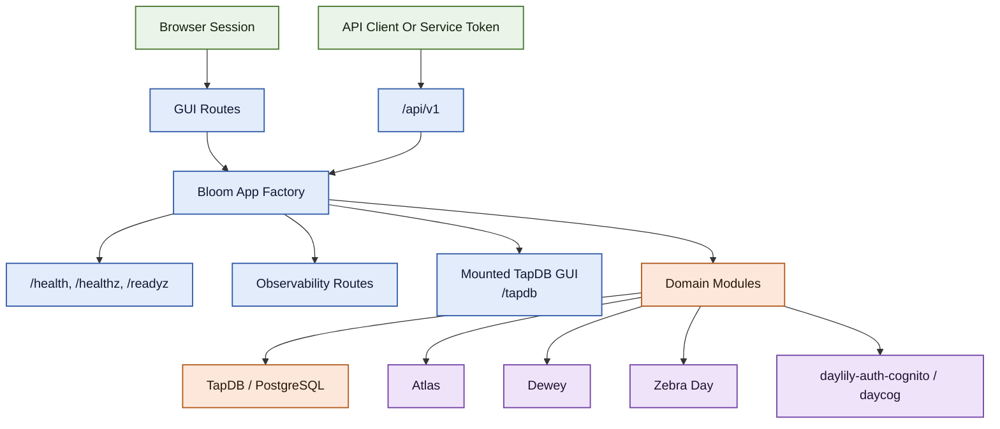

# Bloom Architecture

Bloom is a FastAPI application that combines a versioned HTTP API, a server-rendered GUI, health and observability endpoints, and a mounted TapDB GUI sub-application. Its core architectural decision is narrow ownership: Bloom is authoritative for material primitives and lineage, but it deliberately delegates identity, shared DB/runtime lifecycle, deployment orchestration, and adjacent service concerns to other parts of the Dayhoff bundle.

With pinned `daylily-auth-cognito==2.1.5`, browser/session auth lives in `daylily-auth-cognito.browser.session`, Hosted UI URL and code-exchange helpers live in `browser.oauth` and `browser.google`, bearer verification lives in `runtime.verifier` and `runtime.m2m`, and Cognito lifecycle stays in `daycog` via `admin.*`. Bloom runtime code should not import `daylily_auth_cognito.cli`.

## App Composition

The runtime is assembled in `bloom_lims.app.create_app()` and has the following major pieces:

| Layer | Current behavior |
| --- | --- |
| App factory | Builds the FastAPI app, validates required config at startup, and wires lifespan shutdown for metrics writers. |
| Middleware | Trusted-host filtering, CORS, explicit origin allowlist enforcement, session middleware, per-request observability, request attribution for DB metrics, and optional rate limiting. |
| Static/template mounts | `/static` and `/templates` are mounted as static directories. |
| Health | `/health`, `/health/live`, `/health/ready`, plus top-level `/healthz` and `/readyz`. |
| Observability | Routes such as `/obs_services`, `/api_health`, `/endpoint_health`, `/db_health`, `/api/anomalies`, `/my_health`, and `/auth_health`. |
| API | Versioned router under `/api/v1`. |
| GUI | Dashboard, search, queue runtime, admin, and graph routes. |
| Embedded GUI | Public TapDB GUI app mounted at `/tapdb` by default, using Bloom host-session identity; TapDB applies route permissions. |

Two implementation details matter operationally:

- Startup validation is strict. Bloom aborts startup if TapDB config cannot be resolved or if required Cognito settings are empty.
- The TapDB admin mount is not a second product. It uses the public TapDB host bridge: Bloom ADMIN maps to TapDB admin and other authenticated Bloom users map to TapDB user. There is no separate admin-only wrapper for the entire mount.

## Configuration

Configuration is resolved by `bloom_lims/config.py`. Set `BLOOM_DEPLOYMENT_CODE` explicitly; `activate` does not set it. Runtime callers provide an absolute `BLOOM_CONFIG_PATH`; CLI state/config locations also use explicit `XDG_CONFIG_HOME`. Provisioned deployment-scoped paths are conventions, not permission to discover or guess an existing target.

Bloom YAML supplies TapDB `client_id`, logical `database_name`, `physical_database`, `schema_name`, `owner_repo_name`, `domain_code`, absolute `config_path`, `domain_registry_path` and `prefix_ownership_registry_path`. It also supplies storage, auth, integration and network settings. `storage.upload_dir` is required; settings loading ensures that configured directory exists. There is no supported implicit upload path next to the TapDB config.

`BloomSettings.settings_customise_sources` orders constructor values, `BLOOM_*` environment values, file-secret values, then YAML sources (rendered package template followed by deployment YAML). Explicit environment settings can override YAML; production configuration should be generated and recorded by its owning deployment.

### Startup and operator boundary

The container entrypoint initializes explicit Bloom and TapDB contexts, including native `set_cli_context`, then verifies the existing required templates before server startup. The adapter opens native runtime-role connections. Startup never performs the Aurora migration, template seeding or principal setup.

`bloom db build --target local` is an explicit local bootstrap path. Aurora migration and constrained-principal preparation are separate native operator operations. See [TapDB 10 operations](tapdb_10_operations.md) for exact dependency, immutable-template, identity and sequence rules.

## Runtime Layers

### API Layer: `bloom_lims/api/v1`

This is the versioned HTTP contract. Mounted route groups include:

- objects, containers, content, templates, subjects, and lineages
- auth and token management
- execution queue, batch jobs, async tasks, and stats
- search v2
- graph and tracking
- external specimen and Atlas bridge routes
- beta lab routes under the Atlas integration namespace

Workflow/workset modules still exist on disk, but they are not mounted by the current v1 router.

### GUI Layer: `bloom_lims/gui`

The GUI is mostly server-rendered Jinja templates backed by route families for:

- auth and Cognito callback/logout handling
- the modern dashboard and search pages
- operations views such as queue runtime, equipment, reagents, create flows, and admin
- graph exploration and graph mutation helpers

The Bloom graph browser uses `/dindex2` and `/api/graph/*`. Separately, `bloom_lims/tapdb_dag.py` mounts native TapDB DAG v2 under `/api/dag/v2/*` for consumers such as Kahlo. Mount failure aborts startup; consumers require the advertised `tapdb.dag_v2` extension and exact `dag:v2` contract.

### Domain Layer: `bloom_lims/domain`

The domain layer is where Bloom's narrow ownership becomes concrete:

| Module group | Current responsibility |
| --- | --- |
| `containers.py`, `content.py`, `equipment.py`, `external_specimens.py` | material/object state management |
| `lab_actions.py` | temporary operator actions that create and link extraction plates, sequencing-library plates, pool tubes, sequencing run sets, CSV exports, and barcode print jobs without driving workflow queues |
| `execution_queue.py`, `execution_actions.py` | queue-centric runtime behavior |
| `beta_lab*.py`, `beta_actions.py` | beta queue/lab flows and staged material operations |
| `workflows.py`, `object_sets.py` | older concepts that still exist in code but are not current mounted product surfaces |
| `files.py`, `utils.py`, `base.py` | supporting infrastructure and shared helpers |

### Auth Layer: `bloom_lims/auth`

Bloom's current auth split is:

- browser session auth through Cognito Hosted UI helpers from `daylily-auth-cognito`
- API token auth resolved by Bloom's own token service and RBAC
- group service wrappers around TapDB-backed group membership

Roles are `READ_ONLY`, `READ_WRITE`, and `ADMIN`. Group codes such as `API_ACCESS`, `ENABLE_ATLAS_API`, and `ENABLE_URSA_API` are used as feature gates, especially for external integration routes.

### Integration Layer: `bloom_lims/integrations`

Current notable integrations:

| Integration | Current boundary |
| --- | --- |
| Atlas | reference validation, container context lookup, status-event push, and best-effort outbound Bloom events |
| Dewey | authenticated artifact registration client |
| Zebra Day | printer listing, label profile discovery, and print-job submission |
| TapDB mount | public GUI host-session bridge over the explicit existing runtime config |

Bloom also exposes carrier tracking endpoints under `/api/v1/tracking`, with current FedEx-focused support plus placeholders for other carriers.

## Persistence Model

Bloom persists state through TapDB-managed PostgreSQL structures and namespaced config, not by hand-written one-off local DB bootstrap logic. The working model is:

- templates define allowed object shapes and categories
- object creation mints EUID-backed instances
- authoritative lineage and containment relationships live in `generic_instance_lineage`
- cross-service references use typed external-reference objects plus lineage
- loaded template semantics are immutable; new semantics require new versions, while reviewed bookkeeping updates preserve identities
- operator/runtime surfaces project queue state on top of the same core identity graph

The `/lab-actions` surface follows the same persistence model. It composes existing templates and lineage records into operator-friendly extraction, library, pooling, and sequencing-run setup actions. It does not add tables or queue execution semantics. See [`lab_actions.md`](lab_actions.md) for the concrete template matrix and release boundaries.

That is why Bloom feels like a foundation service rather than a vertical application. It stores the durable material graph that other services and operator workflows can interrogate.

## Health, Observability, And Readiness

Bloom exposes two overlapping health surfaces:

- detailed health under `/health`, `/health/live`, `/health/ready`, and `/health/metrics`
- orchestration aliases under `/healthz` and `/readyz`

Readiness currently checks:

- database connectivity
- that the service is not in maintenance mode

Observability endpoints add rollups for API health, per-endpoint health, DB probes, auth health, and anomaly tracking. These routes are protected by Bloom API auth rather than being anonymously public.

## Security Boundaries

Security-relevant boundaries in the current design:

- GUI sessions use Cognito and a normalized session principal. Raw OAuth tokens are not stored in the session payload.
- Browser routes and API routes have different auth paths, but they share the same Bloom role vocabulary.
- External Atlas/Ursa routes require service-token auth plus group membership gates.
- The TapDB GUI inherits Bloom session identity; ADMIN maps to TapDB admin, and READ_ONLY/READ_WRITE both map to TapDB user. Native TapDB route permissions apply; this is not a one-to-one Bloom role mapping.
- Origin filtering and trusted-host middleware are enforced at the application edge.

## Bloom As A Foundation Service

Bloom is "material primitive authority," not the full LIS stack, because that split keeps the system legible:

- Atlas owns order and intake context.
- Bloom owns material state and lineage.
- Dewey owns artifacts and artifact retrieval.
- Zebra Day owns printing.
- daycog owns shared Cognito lifecycle.
- Dayhoff owns deployment and discoverability.

That separation shows up directly in the codebase. The integrations are thin wrappers. The core data model stays in Bloom.

## Retired And Historical Surfaces

Some names remain in the repo as historical or unmounted modules, but they are not mounted as supported product surfaces today:

- `/api/v1/workflows/*`
- `/api/v1/worksets/*`
- workflow GUI router mounts
- the old `/graph` alias
- retired controls and other legacy utility pages called out in `docs/old_docs/LEGACY_REMOVAL_GAP_REPORT.md`

Use the current mounted routers as the source of truth for supported paths. Existing tests are reference material; their execution is governed by AGENTS.md.
